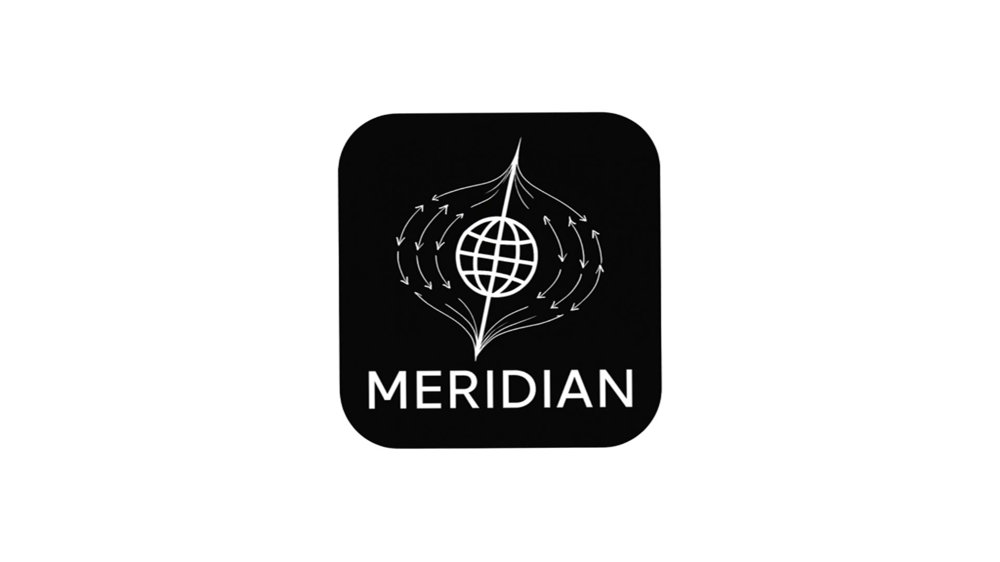

<p align="center">
  
</p>

# Meridian

> A human traceability ledger for agent work: what was asked, when it ran, and where the evidence is.

Meridian keeps one Markdown note per project in your Obsidian vault. Each task in it records the request, the run (dates, repository, branch) and a trace that points to the evidence.

**Division of labour:** Meridian records and points; [gentle-ai](https://github.com/Gentleman-Programming/gentle-ai) (v4, Organic Driven Development plus Engram) generates, executes and remembers the work. Meridian does not plan or orchestrate: `/mdn-run` records the task before work starts, lets ODD do the work, then fills the metadata from git and moves the task to `review` for you.



*One task from request to archive. Editable source: [docs/diagrams/meridian-flow.html](docs/diagrams/meridian-flow.html).*

## How Meridian uses gentle-ai

| gentle-ai produces | Meridian records |
|---|---|
| `odd/tasks/<slug>.md`, the task document, in the repository | The task line with its status in `project.md` |
| Work-unit commits on the feature branch | The Run block: start and end, repo, branch, base |
| An Engram mirror under the topic `odd/<slug>/tasks` | The Trace: link to the `odd/` document (a Windows UNC path), commits, PR |
| | The monthly log `logs/YYYY-MM.md` and the dashboard |

How the two connect:

- gentle-ai v4 has no workflow commands to learn. ODD applies to every request by itself; `/mdn-run` is the only trigger Meridian adds.
- `/mdn-run` writes the task to the vault note **before** the work, then asks ODD to use the task slug as the feature name (`odd/tasks/<slug>.md`).
- If the Meridian config has a `delivery:` sentence, it is passed to ODD verbatim.
- `/mdn-run` runs in the main thread, never as a subagent, and never toggles gentle-ai's receipt-driven review switch.
- Run and Trace are filled from git and `gh` by `mdn-trace.sh`, not from the model's own summary.
- Review is yours: the run ends in `review`, and only `/mdn-done` closes a task.

What is not guaranteed:

- The model can ignore the slug. Meridian then records the real document name it detects.
- Small tasks create no ODD document. The Trace then carries commits and a diffstat only.
- Skill steps are instructions; how faithfully they are followed depends on the model.
- gentle-ai may ask you questions mid-run; `/mdn-run` waits for your answer.
- Meridian cannot ask ODD for its progress. Task state comes from the run itself.
- Windows UNC links are meant for WSL; elsewhere they are plain text pointers.

## Where things live

| What | Where |
|---|---|
| Config, scripts, templates | `~/.config/meridian/` |
| Project note with all tasks | `<vault>/meridian/<project>/project.md` |
| Archived tasks and events | `<vault>/meridian/<project>/logs/YYYY-MM.md` |
| Dashboard (Dataview) | `<vault>/meridian/dashboard.md` |
| ODD task document | `<repo>/odd/tasks/<slug>.md` |
| Engram mirror | topic `odd/<slug>/tasks` |

## Requirements

- An Obsidian vault (any folder of Markdown works; Obsidian is only the viewer).
- [Claude Code](https://claude.com/claude-code) with [gentle-ai](https://github.com/Gentleman-Programming/gentle-ai) v4.0.0 or later for `/mdn-run`. SDD was retired in v4 and ODD is the default workflow, which `/mdn-run` relies on. Codex gets the skills installed, but the ODD flow is only designed for Claude Code with gentle-ai.
- `git` (required by `/mdn-run`); `gh` optional, for the pull request field.
- bash, awk, sed, grep and coreutils for the helper scripts (the lint script was tested with gawk). Links to repository documents are Windows UNC paths and are meant for WSL; elsewhere they are plain text pointers.

## Install

```bash
# Claude Code (default)
bash <(curl -fsSL https://raw.githubusercontent.com/BorjaIP/meridian/main/install.sh)

# Codex
bash <(curl -fsSL https://raw.githubusercontent.com/BorjaIP/meridian/main/install.sh) --tool codex

# From a local checkout (no network), previewing first
git clone https://github.com/BorjaIP/meridian && cd meridian
bash install.sh --source . --dry-run
bash install.sh --source .
```

Options: `--tool claude|codex|all`, `--source <dir>`, `--dry-run`. The installer is idempotent. It writes:

| What | Where |
|---|---|
| Skills | `~/.claude/skills/mdn-*/` (and `~/.codex/skills/` for Codex) |
| Helper scripts (`mdn-lint.sh`, `mdn-trace.sh`, `mdn-migrate.sh`, `mdn-log.sh`, `mdn-index.sh`) | `~/.config/meridian/scripts/` |
| Templates | `~/.config/meridian/templates/` |

Skills from older Meridian versions that no longer exist are moved (not deleted) to `~/.config/meridian/retired-skills-<date>/`, together with a backup of any installed skill it overwrites.

## Quick start

```
/mdn-init name:my-app            # first run asks for your vault path
/mdn-run "add rate limiting to the login endpoint"
/mdn-daily                       # what needs you today
/mdn-done add-login-rate-limit   # accept the result after reviewing it
```

Every command other than `/mdn-init` checks that Meridian is initialized and, if not, runs init for you first.

## Commands

| Command | What it does |
|---|---|
| `/mdn-init` | Create the vault project note; fills the description from the repo. |
| `/mdn-add` | Queue a task (agent or human) without running it. |
| `/mdn-run` | Record a task, run it through ODD, complete Run and Trace, set `review`. |
| `/mdn-done` | Accept a task in `review` (or send it back with a reason). |
| `/mdn-daily` | Everything that needs your attention today. |
| `/mdn-status` | Counts by status and owner across projects. |
| `/mdn-archive` | Move done tasks to the monthly log `logs/YYYY-MM.md`. |

→ [Skills reference](docs/skills.md)

## States

`backlog -> in-progress -> review -> done`, plus `blocked`. `review` means "look at the result", not "it is correct"; only you move a task to `done`. The exact file format, the Run and Trace blocks and the state machine are specified in [docs/protocol.md](docs/protocol.md), and `scripts/mdn-lint.sh <project.md>` validates a note.

## Limits

- The Markdown protocol is agent-agnostic; the installers are not. Only Claude Code and Codex installers exist.
- Skills are instructions for a model. How faithfully they are followed depends on the model; the scripts and `mdn-lint.sh` exist to check the parts that can be checked mechanically.
- Metadata comes from git and `gh`, not from the model's account of itself.
- The `/mdn-run` flow was validated end to end in a sandbox and on the author's own vault. It has not been verified in a fresh session by other people, and it has no automated tests.
- The flow diagram was rendered and checked by eye only, in a rasterizer with a fallback font; the intended fonts and GitHub's rendering were not checked.
- The vault and the repository are separate: the vault holds pointers, the `odd/` documents live in the repository.

## Migrating from the old format

Earlier versions used plans, approvals and several files per project. See section 7 of [docs/protocol.md](docs/protocol.md) and run `scripts/mdn-migrate.sh` (dry run first, `--apply` after reviewing).

## Documentation

| Document | Contents |
|---|---|
| [concepts.md](docs/concepts.md) | What Meridian is, how it relates to ODD and Engram |
| [workflow.md](docs/workflow.md) | A task from request to done |
| [skills.md](docs/skills.md) | One section per command |
| [configuration.md](docs/configuration.md) | Config file, vault layout, installed files |
| [protocol.md](docs/protocol.md) | File format and state machine specification |

## Tests

```bash
bash tests/run.sh
```
