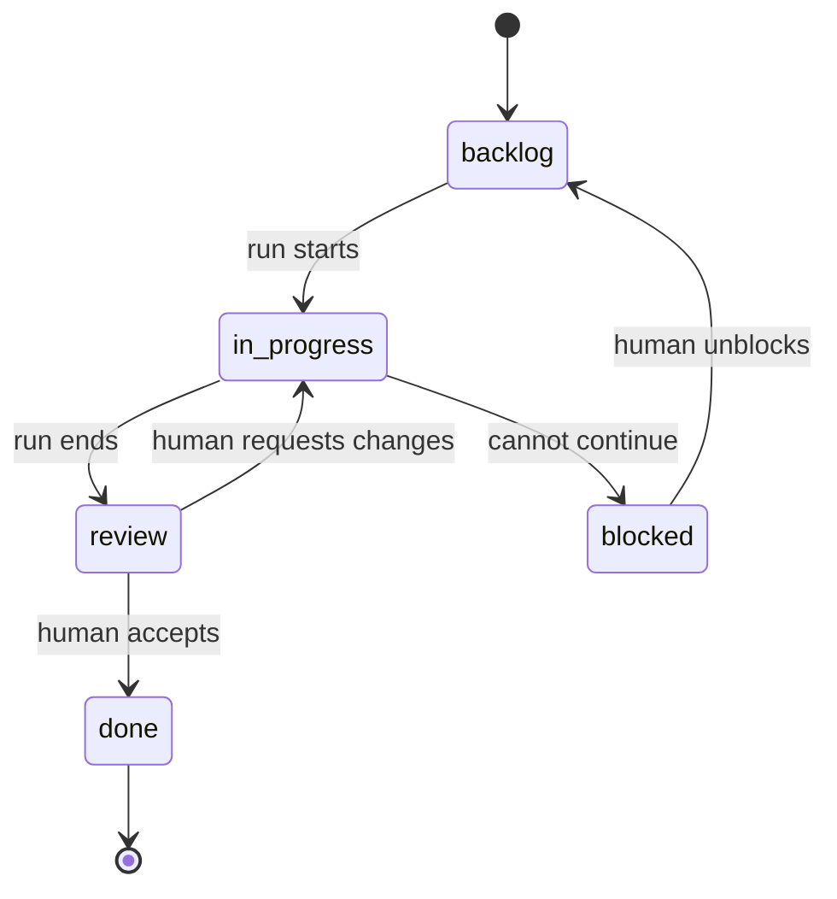

# Protocol Specification

> This document is **agent-agnostic**. Any agent or script can implement a Meridian adapter by following this contract alone. No Obsidian plugin, HTTP API, or shared runtime is required.

Meridian is the human traceability ledger. Execution is owned by the ODD workflow of the coding agent (task documents live in the repository under `odd/`), and agent memory is owned by Engram. A Meridian project file records **what was asked, when it ran, and where the evidence is**.

Validate any project file with `scripts/mdn-lint.sh <project.md>`. Read a digest with `scripts/mdn-index.sh <project.md>`; write logs with `scripts/mdn-log.sh` (sections 8 and 9).

---

## 1. Configuration Resolution

Before any operation, an adapter must resolve the vault path:

1. Read `${XDG_CONFIG_HOME:-$HOME/.config}/meridian/config.md`.
2. Parse the `vault` field from the YAML frontmatter.
3. Use that path as the vault root for all subsequent file operations.

If the config file does not exist, run first-time setup: ask the user for the vault path, write `config.md`, then proceed.

---

## 2. Project File

Each project is **one file**: `<vault>/meridian/<slug>/project.md`.

```markdown
---
title: Sample
project: sample            # kebab-case slug, machine-readable
status: active             # active | paused | done | archived
repo: /home/user/projects/sample   # optional, absolute path of the code repository
tags:
  - project
---
# Sample

> One-line description.

---

## Tasks

- [ ] #task owner::agent status::backlog priority::medium type::chore slug::tidy-readme
  **Title:** Tidy the README
  **Description:** Fix typos and broken links.
```

A file is a Meridian project if its frontmatter has `project:` and `status:`. The filename is not canonical; the `project` field is. Everything below `## Tasks` is task lines and their indented blocks. There are no other required sections and no other files per project.

---

## 3. Task Line

A task is a checkbox line followed by indented blocks.

```
- [ ] #task owner::agent status::review priority::high type::fix slug::fix-login
```

Fields use `key::value` syntax (Dataview-compatible). Order is not significant. All five are required.

| Field | Values | Notes |
|---|---|---|
| `owner` | `me` \| `agent` | Who does the work. |
| `status` | `backlog` \| `in-progress` \| `review` \| `done` \| `blocked` | See section 5. |
| `priority` | `high` \| `medium` \| `low` | |
| `type` | `feature` \| `fix` \| `research` \| `review` \| `chore` | |
| `slug` | kebab-case, unique within the project | Stable task identity. Also used as the feature name of the `odd/` document. Pattern: `^[a-z0-9]+(-[a-z0-9]+)*$`. |

The checkbox mirrors the status: `- [x]` if and only if `status::done`; every other status uses `- [ ]`.

Parsing rule: extract tokens with `/\b(\w+)::(\S+)/g` from the checkbox line.

---

## 4. Blocks

Blocks are indented by two spaces and follow the task line. Order: Title, Description, Acceptance, Run, Trace.

```
  **Title:** <imperative string>
  **Description:** <free text>
  **Acceptance:** <definition of done>          (optional)
  **Run:** started <YYYY-MM-DD HH:MM> · ended <YYYY-MM-DD HH:MM> · repo <path> · branch <name> · base <sha>
  **Trace:** [<label>](<link>) · engram <topic_key> · commits <sha, sha> · PR <#n or url>
```

All dates use ISO format `YYYY-MM-DD HH:MM` (24 hour, local time). Segments are separated by ` · `.

### Run

Written when execution starts and completed when it ends.

- `started` is set when the task moves to `in-progress`. `ended` stays empty until execution stops (`ended` with no value).
- `repo` is the absolute path of the working repository; `branch` is the branch the work was done on: set to the current branch at start and updated at finish to the branch the work ended on.
- `base` (optional) is the short sha of `HEAD` when the run started; commits in `**Trace:**` are those after it. Resuming a run keeps the original `started` and `base`.
- Values come from deterministic commands (`date`, `git rev-parse --abbrev-ref HEAD`), not from model self-report.

### Trace

Pointers to the evidence. Everything after the link is optional except where noted in section 5.

- **Link:** a Markdown link to the `odd/` task document. The link text is the repo-relative path (for example `odd/tasks/fix-login.md`); the target is the Windows UNC path so the file opens from Windows tools, for example `\\wsl.localhost\Arch\home\user\projects\sample\odd\tasks\fix-login.md`. The `odd/` document always lives in the repository; the vault only points to it.
- `engram <topic_key>`: the Engram mirror of the document, for example `engram odd/fix-login/tasks`.
- `commits <sha, sha>`: short commit hashes produced by the work, from `git log`. May be empty only for `owner::me` tasks.
- `PR <#n or url>`: pull request, from `gh pr list`, when one exists.

When a task is small and ODD created no document, the link points to the most useful artifact instead (a changed file, a note), or is omitted when `commits` carries the evidence.

---

## 5. State Machine



`in_progress` is written `in-progress` in files.

| Transition | Who | Meaning |
|---|---|---|
| `backlog -> in-progress` | agent or human | Execution starts. |
| `in-progress -> review` | agent | Execution ended; the human should look at the result. |
| `in-progress -> blocked` | agent or human | Execution cannot continue. |
| `review -> done` | human | Result accepted. |
| `review -> in-progress` | human | Changes requested; execution resumes. |
| `blocked -> backlog` | human | Unblocked and queued again. |
| `any -> blocked` | human | Blocked for external reasons. |

`review` means "look at the result", not "the result is correct". There is no approval gate before execution.

### Status rules

| Status | Requirement |
|---|---|
| `in-progress` | Has a `**Run:**` block with `started`. |
| `review` | Has a `**Trace:**` block. |
| `done` | Has a `**Trace:**` block and the checkbox is `[x]`. |
| any other | Checkbox is `[ ]`. |

`owner::me` tasks may be `review` or `done` without a `**Trace:**` block; when present, their `commits` may be empty. For `owner::agent` tasks the linter requires the block to exist.

Add a `**Note:**` line to a task when `blocked` to record why.

---

## 6. Parsing Contract

A client needs these primitives plus config resolution:

```
CONFIG  read vault path from ${XDG_CONFIG_HOME:-$HOME/.config}/meridian/config.md
READ    project file by frontmatter field  (project: <slug>)
GREP    task lines  /^- \[.\] #task/  filtered by inline fields
EDIT    inline field value in place  (status::X -> status::Y) and the checkbox
INSERT  block of lines after a given line number
WRITE   new markdown file at a given vault path
```

No plugin. No API. No shared runtime.

---

## 7. Migration from the old format

Earlier versions of Meridian used a larger model. Tools that read old vaults need this mapping.

| Retired concept | Old meaning | New format |
|---|---|---|
| `planning` state | Agent drafting a plan. | Map to `backlog`; keep any plan text as a `**Note:**`. |
| `approved` state | Human approved a plan; ready to run. | Map to `backlog`. |
| `plans/` folder and Plan index notes | One note per plan with an artifacts table. | Removed. The `odd/` document in the repository replaces it; link it from `**Trace:**`. |
| Project `## Plans` and `## Sources` sections, Tasks table | Index tables. | Removed. The `## Tasks` inline lines are the only index. |
| `tasks/` folder, `Task.md` template | One file per task. | Task becomes an inline entry in `project.md`. |
| `**Artifact:**` and `**Depends on:**` blocks | Plan link and ordering. | `**Trace:**` link; ordering is by position in the file. |
| Verification checkpoint tasks (`type::review` created by the agent) | Human check after execution. | Removed. The task itself moves to `review`. |
| `REVIEW.md`, `GOAL.md` | Reviewer reports and loop goal. | Removed. |
| `PROGRESS.md`, `checkpoints/` | Session memory. | Removed. Engram owns agent memory. |
| `TASK_HISTORY.md` | Archived done tasks. | Replaced by `logs/YYYY-MM.md` (section 8). Archived tasks are still moved verbatim, never deleted. |

Conversion rules for a legacy project:

1. Keep the frontmatter; drop the `## Sources`, `## Plans` sections and the Tasks table; add `repo:` when known.
2. Convert every task to the new line. Add a `slug` (kebab-case from the title, made unique), and `priority::medium` when missing.
3. Map states as above. Existing `review` tasks with an `**Artifact:**` stay `review` and gain a `**Trace:**` link when one can be derived.
4. Move legacy files to `archive-legacy/` instead of deleting them.
5. Run `scripts/mdn-lint.sh` on the result.

---

## 8. Logs

Cold storage lives next to the project note: `<vault>/meridian/<slug>/logs/YYYY-MM.md`, one file per month, **append-only**. It replaces `TASK_HISTORY.md`. `project.md` stays the hot working set; logs hold what is closed or old.

Each month file starts with `# Log YYYY-MM` and holds two kinds of entries, every one timestamped `YYYY-MM-DD HH:MM` (local time, taken from the clock by the script):

- **Lifecycle event**, one line: `- <timestamp> · <event> · <slug>[ · <text>]`. `slug` is `-` for project-level events. Events: `init`, `created`, `run-started`, `run-finished`, `blocked`, `review`, `done`, `reopened`, `archived`, `migrated`.
- **Archived task**, a section: `## <timestamp> · archived · <slug>` followed by the complete task block (task line plus Title, Description, Run, Trace, Note) copied verbatim, indentation preserved.

Entries are only written through `scripts/mdn-log.sh`, never hand-formatted:

```
mdn-log.sh event   <project-dir> <event> <slug> [text...]
mdn-log.sh archive <project-dir> <project.md> <slug>
```

`archive` moves the block out of `project.md` (and one trailing blank line) into the month file. Both writes go through temp files and are moved into place only when the task is found, so a failure changes nothing. Exit codes: `2` bad arguments or event, `3` slug missing or task not done, `4` that slug is already archived in that month. `MDN_NOW="YYYY-MM-DD HH:MM"` overrides the clock for tests.

Daily, status and the digest never read `logs/`; they are for history and audit.

---

## 9. Digest and warnings

`scripts/mdn-index.sh <project.md> [--now "YYYY-MM-DD HH:MM"] [--stale-hours 24] [--done-hint 20]` computes what dashboards need, so clients read its output instead of the whole note. It reads only the given file. Output is `key=value` lines, repeated keys carry one item per line with tab-separated fields:

| Line | Meaning |
|---|---|
| `project=<slug>`, `total=<n>` | Project slug and task count. |
| `counts <status>=<n>` | One line per status, zeros included. |
| `owner_counts <owner>=<n>` | `me` and `agent`. |
| `review=<slug>`, owner, priority, title, `trace=<link text>` | One per task in `review`; `trace=` is empty without a Trace block. |
| `blocked=<slug>`, owner, priority, title, note | One per blocked task; note is the `**Note:**` text, if any. |
| `mine=<slug>`, status, priority, title | `owner::me` tasks in `backlog` or `in-progress`. |
| `stale=<slug>`, `<started>` or `no-run` | `owner::agent` tasks in `in-progress` whose `Run` started more than `--stale-hours` ago (strictly), or that have no usable `Run`. |
| `done_count=<n>` | Number of done tasks. |
| `archive_hint=yes` | Printed only when `done_count` is greater than `--done-hint`; suggest archiving. |

`mdn-lint.sh` also prints **warnings**, as `file:line: warning: ...`, that never change the exit status. Today there is one: a task description over 600 characters (continuation lines included). Keep the description short and move the detail to the `odd/` task document.
